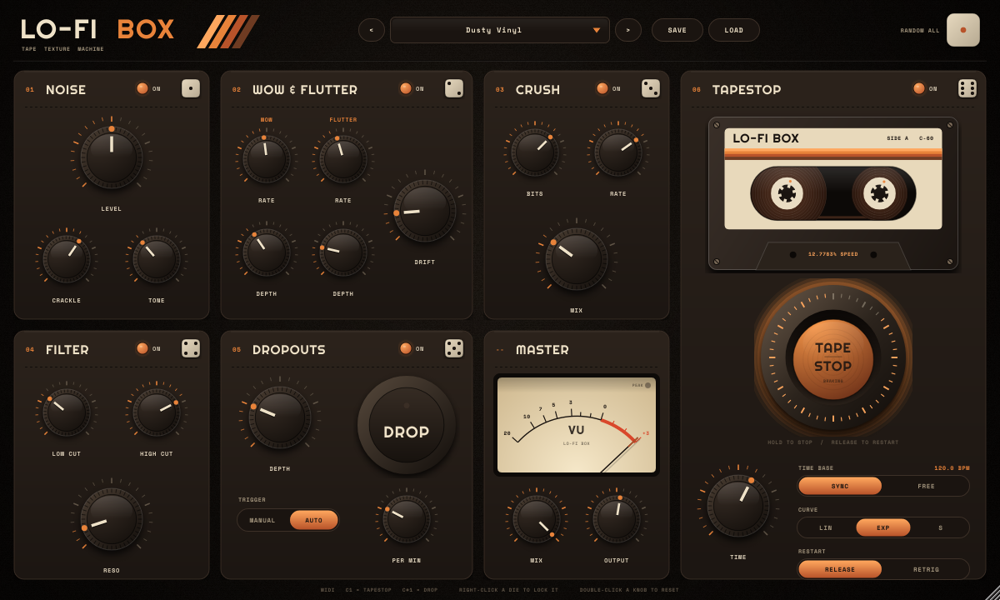

# Lo-Fi Box

Caja de texturas lo-fi: **NOISE → WOW & FLUTTER → CRUSH → FILTER → DROPOUTS → TAPESTOP → MIX → OUTPUT**.
JUCE 7/8 · CMake · AU, VST3 y Standalone (Mac). Mono y estéreo.



## Árbol de archivos

```
LoFiBox/
├── CMakeLists.txt
├── README.md
├── Resources/Fonts/            Righteous + Space Mono (licencia OFL, embebidas)
├── Source/
│   ├── PluginProcessor.h/.cpp  APVTS, MIDI sample-accurate, estado, presets, dados
│   ├── PluginEditor.h/.cpp     GUI de una página (1200x720, escalable)
│   ├── Parameters.h/.cpp       IDs, layout, rangos de los randomizers
│   ├── Presets.h/.cpp          7 presets de fábrica + presets de usuario (.lofibox)
│   ├── dsp/
│   │   ├── DSPCommon.h         smoothing, delay Hermite, SVF TPT, RNG, anti-denormals
│   │   ├── NoiseModule.h
│   │   ├── WowFlutterModule.h
│   │   ├── CrushModule.h
│   │   ├── FilterModule.h
│   │   ├── DropoutModule.h
│   │   ├── TapeStopModule.h
│   │   └── LoFiChain.h         cadena completa (sin dependencia de AudioProcessor)
│   └── gui/
│       ├── LoFiLookAndFeel.h/.cpp
│       └── Components.h/.cpp   Knob, Dado, botón TAPE STOP, DROP, VU, Cassette, paneles
└── tools/DSPTest.cpp           app de consola: null test + render a WAV
```

## Compilar en Mac

Requisitos: Xcode (o sus Command Line Tools: `xcode-select --install`), CMake ≥ 3.22 (`brew install cmake`) y git.

```bash
cd LoFiBox

# Opción A — Ninja/Make (rápido). JUCE 8.0.10 se descarga solo la primera vez.
cmake -B build -DCMAKE_BUILD_TYPE=Release
cmake --build build --config Release -j8

# Opción B — proyecto de Xcode
cmake -B build-xcode -G Xcode
open build-xcode/LoFiBox.xcodeproj        # o: cmake --build build-xcode --config Release
```

- Si ya tienes JUCE clonado, agrega `-DJUCE_DIR=/ruta/a/JUCE` (funciona con JUCE 7.0.x y 8.x).
- Por defecto compila **universal** (arm64 + x86_64). Para compilar más rápido solo en tu Mac: `-DCMAKE_OSX_ARCHITECTURES=arm64`.
- Los plugins se copian automáticamente a `~/Library/Audio/Plug-Ins/VST3/` y `~/Library/Audio/Plug-Ins/Components/`.
- App standalone: `build/LoFiBox_artefacts/Release/Standalone/Lo-Fi Box.app` (con Xcode es la misma ruta; con Ninja/Make puede no llevar `Release/`).

Validar el AU y forzar a Logic a reescanear:

```bash
killall -9 AudioComponentRegistrar 2>/dev/null
auval -v aumf LfB1 Lfbx
```

Probar el DSP sin host:

```bash
./build/LoFiBoxDSPTest_artefacts/Release/LoFiBoxDSPTest              # genera señal de prueba
./build/LoFiBoxDSPTest_artefacts/Release/LoFiBoxDSPTest mi_loop.wav  # procesa tu archivo
```

Escribe `lofibox_test_out.wav` (modo momentáneo) y `lofibox_test_out_toggle.wav` (modo retrigger), y verifica:
null test con todo en bypass (error 0), ausencia de NaN/denormals y picos.

## MIDI

| Nota | Acción |
|---|---|
| **36 (C1)** | TAPESTOP — note-on = apretar, note-off = soltar |
| **37 (C#1)** | DROPOUT — la velocity escala la profundidad (50–100 %) |

Logic: el AU es tipo *MIDI-controlled Effect* (`aumf`); elige "Lo-Fi Box" en el selector de side-chain MIDI de una pista de instrumento. Ableton: en una pista MIDI elige *MIDI To → pista de audio → Lo-Fi Box*.
En la app standalone, la **barra espaciadora** también funciona como el botón TAPE STOP.

## Decisiones que tomé (lo ambiguo)

**Cadena y latencia**
- El ruido entra **primero**: así el hiss también flamea con el wow y se frena con el tapestop, igual que en una cinta real.
- WOW & FLUTTER usa un delay modulado con base **fija de 24 ms**, que se reporta al host como latencia (+ ~1 ms del oversampling del CRUSH). Es constante aunque apagues módulos, así que el DAW la compensa siempre. El MIX global retrasa el dry esa misma cantidad (no hay efecto peine).
- La profundidad de wow y flutter está en **cents** (wow 0–50, flutter 0–15): la amplitud del delay se calcula como `cents / (2π·rate)`, así "depth" suena igual a cualquier rate. Bajo ~0.25 Hz el wow queda limitado por el delay disponible (18 ms).
- DRIFT agrega tres ruidos de control suaves: desplazamiento lento de la velocidad, variación del rate del wow (±35 %) y de la profundidad del flutter.

**Módulos**
- NOISE: la densidad va de 0 a 30 crackles/seg (proceso de Poisson), ~3,5 % son "pops" más grandes. El tone va de oscuro (500 Hz) a brillante (14 kHz) y filtra hiss y crackles.
- CRUSH: 2x oversampling con FIR de fase lineal y latencia entera. Bits continuos (el knob se mueve suave, sin escalones). El sample rate llega hasta 48 kHz ("OFF" = sin reducción).
- FILTER: SVF de 12 dB/oct. La resonancia va de Q 0.707 a 2.2 en el LP y ~60 % de eso en el HP: suave, nunca silba.
- DROPOUTS: en DEPTH 0 la ganancia baja −1,5 dB y el pitch ~−7 cents; en 100 llega a −60 dB y ~−2 semitonos. El pitch baja de verdad (lectura a velocidad variable). Al terminar, el retraso acumulado se recupera con una aceleración suave limitada a +3 % de velocidad, como un capstan que retoma. Cada flanco dura como mínimo 12 ms con forma raised-cosine (más que los 2–5 ms pedidos). La duración se sortea entre 50 y 400 ms, sesgada hacia eventos cortos. En AUTO, el botón manual y el MIDI siguen funcionando.
- TAPESTOP: buffer de 17 s con cabezal de lectura a velocidad variable; pitch y velocidad son literalmente lo mismo. Curvas: **LIN**; **EXP**, que cae rápido y deja una cola larga y grave; y **S**. El arranque recorre la misma curva en espejo. Al terminar el arranque, la lectura va atrasada respecto del audio en vivo, así que hago un crossfade equal-power de 12 ms de vuelta al "live". Fades de 4 ms al llegar a velocidad 0 y al salir de ella, más un DC-blocker de 5 Hz. Si lo vuelves a disparar a mitad de camino, invierte la dirección de forma continua.
- Modos de reinicio: **RELEASE**, momentáneo (mantener = frena, soltar = arranca), y **RETRIG**, toggle (un golpe frena y queda detenido, otro arranca).
- Sync: 1/16, 1/8, 1/4, 1/2, 1 compás y 2 compases, según el BPM y el compás del host (120 BPM si no hay host). En modo libre: 30 ms–4 s.

**Randomizers** (nunca tocan bypass, triggers, modos, MIX ni OUTPUT)
- Noise −50…−28 dB, crackle 0,3–12/s, tone 20–75 %.
- Wow 0,25–1,3 Hz / 4–32 ct, flutter 4–9 Hz / 0,5–7 ct, drift 5–70 %.
- Crush 6–13 bits, 4,5–24 kHz, mix 25–80 %.
- Filter: HP 30–320 Hz; el LP queda siempre por lo menos 12× sobre el HP (mín. 2,5 kHz, máx. 14 kHz); reso 0–50 %.
- Dropouts: depth 15–75 %, 1–15 por minuto.
- Tapestop: en sync, de 1/8 a 1 compás; en free, 150–1500 ms; curva al azar.
- Varios rangos están sesgados hacia valores bajos (más sutil más seguido).
- **Click derecho en un dado = candado**: ese módulo queda fuera del dado global.
- "Posiciones de los dados" en el estado: se guardan la cara visible de cada dado (1–6) y los candados, además del nombre del preset.

**Presets**
- 7 de fábrica: Init, Dusty Vinyl, Worn Cassette, AM Radio 1940, Lo-Fi Beats, Broken Walkman y Tape Stop Only. También aparecen como *programs* del host.
- SAVE/LOAD guardan archivos `.lofibox` (XML del estado completo) en `~/Music/Lo-Fi Box Presets`, y aparecen en la lista bajo "USER".

**Calidad**
- Todos los parámetros continuos se suavizan en 20 ms (los cutoffs en dominio logarítmico).
- Bypass por módulo con crossfade de 10 ms. `ScopedNoDenormals` más `snapToZero` en todos los estados de filtros.
- Cero allocations en el audio thread. MIDI con precisión de sample (el bloque se trocea en cada evento).

## Instaladores para Mac y Windows (GitHub Actions)

`.github/workflows/build.yml` compila en máquinas Mac y Windows reales de GitHub (gratis en repos públicos; en privados consume minutos del plan) y genera:

- **Mac**: `LoFiBox-<versión>-mac.pkg` (universal Apple Silicon + Intel). Permite elegir VST3, AU y/o la app standalone. Antes de empaquetar se valida el AU con `auval`.
- **Windows**: `LoFiBox-<versión>-windows-setup.exe` (Inno Setup, x64). Instala el VST3 en `C:\Program Files\Common Files\VST3` y, opcionalmente, la app standalone.

Pasos:
1. Sube esta carpeta a un repo de GitHub (rama `main`).
2. Abre **Actions → Build installers**. Corre solo con cada push, o a mano con *Run workflow*.
3. Al terminar, descarga los instaladores en la sección *Artifacts* de esa ejecución.
4. Para publicar un Release: `git tag v1.0.0 && git push --tags`. Los dos instaladores quedan adjuntos al Release.

Scripts locales equivalentes: `installer/mac/build_pkg.sh` (en un Mac) e `installer/windows/LoFiBox.iss` (en Windows con Inno Setup).

### Firma (importante para compartirlo)
- **Mac sin firmar**: Gatekeeper bloquea el .pkg al abrirlo. Para instalar: click derecho → *Abrir*, o *Ajustes del Sistema → Privacidad y seguridad → Abrir igualmente*. Para distribuirlo sin fricción necesitas una cuenta Apple Developer (USD 99/año). Con ella, agrega estos *secrets* al repo: `MAC_APP_SIGN_ID`, `MAC_INSTALLER_SIGN_ID`, `NOTARY_APPLE_ID`, `NOTARY_TEAM_ID` y `NOTARY_PASSWORD`. Además hay que importar los certificados Developer ID en el keychain del runner (paso no incluido). Con eso el workflow firma y notariza solo.
- **Windows sin firmar**: SmartScreen muestra "Windows protegió tu PC" → *Más información → Ejecutar de todas formas*. Para evitarlo hace falta un certificado de firma de código.
